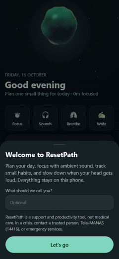

# ResetPath

**A private, offline daily companion for students.** Plan the day, track small
habits, focus with a timer and ambient sound, and slow down when your head gets
loud. Everything stays on your phone.

> ResetPath is a support and productivity tool, not medical treatment, a
> diagnostic system, or a crisis service.

<p align="center">
  <a href="docs/demo.mp4"></a>
</p>
<p align="center"><a href="docs/demo.mp4">Watch the full-quality video (MP4)</a></p>

## What it does

- **Today** — mood check-in, today's tasks by track (DSA, Core CS, Project,
  Applications, Personal), one-tap carry-over of unfinished tasks, and daily
  habits with counters (for example, water 0/8).
- **Focus** — Pomodoro timer (15–90 minutes, 5–15 minute breaks) tied to a
  task, with optional ambient sound, a chime, vibration, and a notification
  when a block ends.
- **Sounds** — a built-in ambient sound mixer: rain, ocean, stream, wind, fire,
  night crickets, fan, and white, pink, and brown noise. Mix them, use a
  preset, and set a sleep timer that fades out. All sound is generated on the
  device, so there are no audio files and it works offline with the screen off.
- **Calm** — guided breathing (calm 4·6, box, 4·7·8) paced by the 3D orb, a
  four-step 2-minute reset, and a private journal with writing prompts.
- **You** — focus minutes for the week, a five-week habit heatmap, a
  two-week mood strip, tasks done by track, settings, backup and restore, and
  human-support contacts.

The background is a live three.js scene: a soft orb that breathes with the
breathing guide, reacts to the sound mix, pulses when you finish things, and
shows focus progress as a ring. **You can play with it.** Touch it and it dents
softly, sends a glowing ripple across its surface, and plays a quiet pentatonic
note that rises with where you touch. Drag to spin it, and flick to let it
drift. Motion can be set to Full, Low (half frame rate), or Off.

## Download for Android

Build it locally (below). The APK is about 300 KB. Version 0.2 was about
117 MB.

Installing over ResetPath 0.1 or 0.2 keeps your data. On first launch the app
reads the old database and copies over tasks, diary pages, reflections, the
trusted contact, and the theme.

## Build

Requirements: the Android SDK (build-tools and one platform), a JDK 17 or
newer, Python 3.10 or newer, and Node 20 or newer for the tests. You do not
need Gradle, Flutter, or network access.

```powershell
python tools\build_apk.py
```

The signed APK is written to `dist\resetpath.apk`. It is signed with the
Android debug keystore unless `RESETPATH_KEYSTORE`, `RESETPATH_KEY_ALIAS`, and
`RESETPATH_KEYSTORE_PASS` are set.

Run it in a browser while developing:

```powershell
npm run serve
```

Then open http://127.0.0.1:8765. Run the tests:

```powershell
npm test
```

## How it is built

| Path | What it is |
| --- | --- |
| `web/` | The app: plain HTML, CSS, and ES modules, with no build step |
| `web/js/app.js` | Screens, navigation, and interaction |
| `web/js/noise.js` | Web Audio sound engine and procedural sound generators |
| `web/js/scene.js` | three.js background (orb shader, particles, progress ring) |
| `web/js/store.js` | Local storage, backup format, and import from 0.1/0.2 |
| `web/js/logic.js` | Pure helpers: dates, stats, support text, crisis-language check |
| `android/` | Native shell: a WebView, file save/open, keep-awake, notifications, and a media-playback foreground service |
| `tools/build_apk.py` | Gradle-free APK build using aapt2, javac, d8, zipalign, and apksigner |
| `tests/` | `node --test` suites for logic, storage, and sound generation |

The WebView serves the bundled files from a virtual `https://appassets.androidplatform.net`
origin and blocks every other request. The app has no network access.

## Privacy and safety

Data lives in the app's private WebView storage on the phone. There is no
account, backend, analytics, or advertising SDK. A backup is a JSON file that
you save yourself. Read [PRIVACY.md](PRIVACY.md).

When the reset flow or a journal page contains explicit self-harm language,
ResetPath shows human-support options. If someone may act on thoughts of
self-harm, contact a trusted person, professional support, or emergency
services immediately. In India, Tele-MANAS is **14416** or
**1800-89-14416** ([official site](https://telemanas.mohfw.gov.in/home)).

## Known limitations

- The build is signed with the debug key; it is not a Play Store release.
- Background sound depends on the WebView staying alive. The foreground
  service and wake lock help, but aggressive battery savers (some MIUI,
  ColorOS, or One UI settings) can still stop it. Allow ResetPath to run in the
  background if sound stops.
- The emotion router, wearable import, and charts library from 0.2 were
  removed. See [CHANGELOG.md](CHANGELOG.md).
- This build has not yet been tested on a physical phone; see the changelog.

More detail: [User manual](docs/USER_MANUAL.md).
