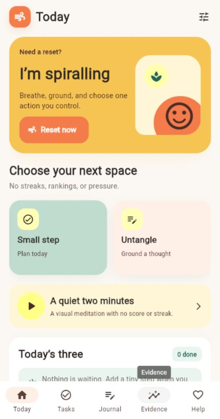
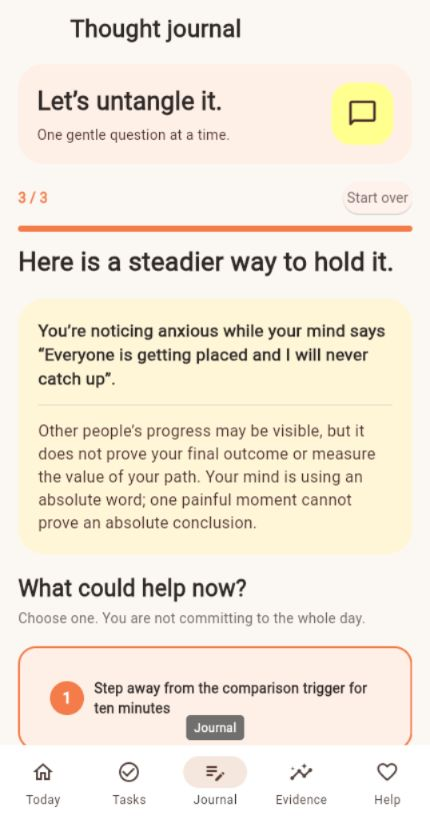

# ResetPath

ResetPath is a private, local-first Android app for students dealing with
comparison anxiety and placement fear. It helps you pause, name the thought,
choose one manageable action, and keep evidence of work you completed.

> ResetPath is a support and progress tool. It is not medical treatment, a
> diagnostic system, or a crisis assessment.

## Download for Android

[**Download ResetPath for Android phones (ARM64)**](https://github.com/Nikhi00718/ResetPath/releases/latest/download/ResetPath-v0.2.0-arm64.apk)

The APK is a personal testing build signed with a debug certificate. Android
may ask you to allow installation from your browser or file manager. The
repository and release are public, so GitHub sign-in is not required.

The smaller ARM64 build is recommended for most modern Android phones. If
Android reports that it is incompatible, choose the matching alternate build
from the [release page](https://github.com/Nikhi00718/ResetPath/releases/latest).

After downloading:

1. Open `ResetPath-v0.2.0-arm64.apk`.
2. Allow installation from this source if Android asks.
3. Install and open ResetPath.
4. Read the short safety notice and add support contacts if you want.

The release page includes a SHA-256 checksum so the downloaded file can be
verified.

## What ResetPath includes

- a five-step **Reset now** flow with animated breathing and grounding;
- a one-question-at-a-time thought journal;
- reviewed local retrieval that chooses relevant grounded wording and actions;
- conservative self-harm-language redirection to human support;
- three daily placement tasks across DSA, Core CS, projects, and applications;
- an animated evidence journal with private progress charts;
- 2, 5, and 10 minute visual meditation;
- soft haptic feedback on supported phones;
- voice typing through the phone keyboard without ResetPath recording audio;
- a free-form, private diary page with export and local storage;
- persisted light and dark themes;
- in-app back navigation that returns to the previous ResetPath screen.
- an optional on-device emotion router and diary-context retrieval; diary text
  is never used for model training.
- local CSV/JSON wearable import for sleep, resting heart rate, HRV, and steps;
- optional mood and energy check-ins;
- local ZIP export and confirmed delete-all;
- trusted-person, campus support, and Tele-MANAS actions.

There are no accounts, advertisements, rankings, leaderboards, streak
punishments, or cloud journal uploads.

## Screens





## Privacy and safety

Tasks, reflections, mood check-ins, and imported wearable readings are stored in
the app's private SQLite database. The database is not additionally encrypted,
so device security still matters. ResetPath does not send this data to a
ResetPath server because v0.1 has no remote backend.

Wearable readings are shown only as context. ResetPath does not calculate a
"stress score," diagnose anxiety, infer whether somebody is safe, or recommend
ignoring how they feel.

The thought-support feature is not an unrestricted chatbot. It retrieves one
entry from a reviewed local support library, then fills a fixed response
structure. It cannot execute actions without a user tap.

Read the full [privacy notes](PRIVACY.md) and
[product safety rules](docs/01_PRODUCT_AND_SAFETY.md).

For human support in India, Tele-MANAS is described as a 24/7 free mental-health
helpline: [14416](tel:+9114416?oai_link_source=model_response_hotline).
Official website:
[https://telemanas.mohfw.gov.in/home](https://telemanas.mohfw.gov.in/home?oai_link_source=model_response_hotline).

If someone may act on thoughts of self-harm or cannot remain safe, ResetPath
directs them to contact a trusted person, professional support, or local
emergency services immediately. The app never decides that somebody is safe.

## Architecture

```text
Flet interface
    |
    +-- deterministic safety gate (always first)
    +-- reviewed local support retrieval (JSON, no network)
    +-- SQLite repository
    |     +-- tasks and evidence
    |     +-- thought entries
    |     +-- mood check-ins
    |     +-- wearable context
    +-- Pandas + Flet Charts
    +-- Android services (haptics, links, files)
```

The application backend is local Python code:

- `app.py` — responsive interface, flows, animation, and device services;
- `logic.py` — validation, crisis-language gate, and reviewed retrieval;
- `database.py` — SQLite schema, migrations, export, and deletion;
- `wellbeing.py` — strict wearable-file parsing with no health inference;
- `assets/support_library.json` — reviewed offline support cards.

## Voice and watch support

Voice typing in v0.1 uses the microphone button on the installed phone keyboard.
ResetPath receives the resulting text and does not record audio. Whether
dictation is offline depends on the keyboard provider and its settings.

Watch data works now through a private CSV or JSON import. A template is
available inside **Evidence → Body & mood context**.

Direct Android Health Connect sync is not falsely presented as complete. A
production connector needs a native Android extension, a privacy-rationale
activity, and explicit read permissions. The planned connector is read-only for
sleep, resting heart rate, HRV, and steps. See the
[v0.1 device-feature plan](docs/08_V1_RELEASE_AND_DEVICE_FEATURES.md).

## Run on a laptop

Requires Python 3.14.

```powershell
git clone https://github.com/Nikhi00718/ResetPath.git
cd ResetPath
py -3.14 -m venv .venv
.\.venv\Scripts\Activate.ps1
python -m pip install -r requirements.txt
flet run app.py
```

If Windows blocks the generated `flet.exe` launcher:

```powershell
.\.venv\Scripts\python.exe tools\flet_runner.py run app.py
```

Run tests:

```powershell
.\.venv\Scripts\python.exe -m unittest discover -s tests -v
```

Build Android:

```powershell
.\.venv\Scripts\python.exe tools\launch_android_build.py
```

## Documentation

1. [Product and safety](docs/01_PRODUCT_AND_SAFETY.md)
2. [Architecture and backend](docs/02_ARCHITECTURE_AND_BACKEND.md)
3. [Frontend and user flows](docs/03_FRONTEND_AND_USER_FLOWS.md)
4. [Implementation step by step](docs/04_IMPLEMENTATION_STEP_BY_STEP.md)
5. [Mobile build and release](docs/05_MOBILE_BUILD_AND_RELEASE.md)
6. [Testing, privacy, and roadmap](docs/06_TESTING_PRIVACY_AND_ROADMAP.md)
7. [Local retrieval, voice, and meditation](docs/07_LOCAL_AI_RAG_VOICE_AND_MEDITATION.md)
8. [Production readiness and device roadmap](docs/09_PRODUCTION_READINESS_AND_DEVICE_ROADMAP.md)
9. [Local emotion router evaluation](docs/emotion-router-evaluation.json)
8. [v0.1 release and device features](docs/08_V1_RELEASE_AND_DEVICE_FEATURES.md)

## Release status

Automated checks cover safety matching, validation, task/evidence behavior,
SQLite migration, private export, delete-all, reviewed retrieval, wearable
parsing, and mood storage. A physical Android-device smoke test is still
recommended for haptics, file-picker behavior, dialler links, keyboard
dictation, and data persistence after a reboot.

See [CHANGELOG.md](CHANGELOG.md) for release notes.
