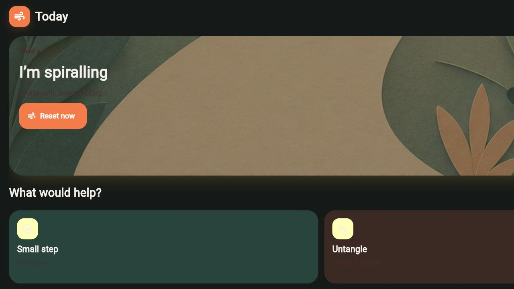

# ResetPath

**A private, local-first wellbeing and placement-progress companion for
students.** ResetPath helps you pause during comparison spirals, write freely,
choose one manageable action, and notice the evidence of work you have done.

> ResetPath is a support and progress tool — not medical treatment, a
> diagnostic system, or a crisis-assessment service.




## Download for Android

[**Download ResetPath v0.2.0 for most Android phones (ARM64)**](https://github.com/Nikhi00718/ResetPath/releases/latest/download/resetpath-arm64-v8a.apk)

This is a personal testing build, signed with a debug certificate. It is about
117 MB. On Android, open the downloaded `resetpath-arm64-v8a.apk`, allow your
browser or file manager to install unknown apps when prompted, then install.
If your phone says the APK is incompatible, use the matching build on the
[release page](https://github.com/Nikhi00718/ResetPath/releases/latest).

For a complete first-use walkthrough, see the [User Manual](docs/11_USER_MANUAL.md).

## What you can do

- **Reset now** — a calm five-step breathing, grounding, thought, facts, and
  next-action flow.
- **Daily progress** — choose small DSA, Core CS, project, or application
  tasks with no rankings, streak pressure, or leaderboards.
- **Private diary** — write normal diary pages, reopen them later, export them,
  or delete all local data.
- **Optional guided reflection** — unpack one thought at a time and choose a
  grounded next action.
- **Evidence and progress** — turn completed tasks into a personal record and
  view private charts.
- **Meditation and gentle haptics** — short visual sessions with vibration on
  supported phones.
- **Human help** — trusted-person, campus-support, and Tele-MANAS actions.
- **Light or dark appearance** — your choice is stored on the device.

## Private local AI — with boundaries

v0.2 includes a compact offline communication-tone router and an **opt-in**
local diary retrieval option for a single guided reflection. The model was
trained on the public [dair-ai/emotion dataset](https://huggingface.co/datasets/dair-ai/emotion),
not on ResetPath diary pages or health data.

It can offer a broad tone hint, such as fear or sadness, but you always choose
your own emotion. It does not diagnose a condition, calculate a stress score,
assess safety, or replace human support. The detailed model card and evaluation
are in [Local emotion router](docs/10_LOCAL_EMOTION_ROUTER.md).

## Versions

| Version | Status | Highlights |
| --- | --- | --- |
| [v0.2.0](https://github.com/Nikhi00718/ResetPath/releases/tag/v0.2.0) | Current | Freeform diary, optional local diary context, offline emotion router, theme preference, improved back navigation. |
| [v0.1.0](https://github.com/Nikhi00718/ResetPath/releases/tag/v0.1.0) | Previous | Reset flow, tasks, evidence, meditation, local support cards, wearable-file import, and Android build. |

Read the full, version-by-version [changelog](CHANGELOG.md).

## Known limitations

- This release is a debug-signed testing APK, not a Play Store production app.
- Direct Samsung Health, Google Fit, and Health Connect syncing are **not** in
  the app yet. It supports manual CSV/JSON wearable import only.
- Voice typing uses the microphone feature of your installed keyboard; ResetPath
  does not record or retain audio.
- The local model is a non-clinical broad-emotion classifier, not a mental
  health model or an autonomous agent.
- Physical-device testing is still needed for every target phone, especially
  haptics, keyboard dictation, file selection, and back navigation.

The full list is in [Limitations and release readiness](docs/12_LIMITATIONS.md).

## Privacy and safety

ResetPath stores its tasks, diary pages, reflections, and imported wearable
readings locally in its private SQLite database. v0.2 has no ResetPath cloud
backend and does not upload journal text. The database is not additionally
encrypted, so your phone lock screen and device security remain important.

If someone may act on thoughts of self-harm or cannot remain safe, ResetPath
directs them to contact a trusted person, professional support, or local
emergency services immediately. In India, Tele-MANAS lists **14416** and
**1800-89-14416**: [official site](https://telemanas.mohfw.gov.in/home).

Read the full [privacy notes](PRIVACY.md) and [product safety rules](docs/01_PRODUCT_AND_SAFETY.md).

## Run locally

Requires Python 3.14.

```powershell
git clone https://github.com/Nikhi00718/ResetPath.git
cd ResetPath
py -3.14 -m venv .venv
.\.venv\Scripts\Activate.ps1
python -m pip install -r requirements.txt
flet run app.py
```

Run checks:

```powershell
.\.venv\Scripts\python.exe -m unittest discover -s tests -v
```

Build Android:

```powershell
.\.venv\Scripts\python.exe tools\launch_android_build.py
```

## Documentation

1. [User Manual](docs/11_USER_MANUAL.md)
2. [Limitations and release readiness](docs/12_LIMITATIONS.md)
3. [Product and safety](docs/01_PRODUCT_AND_SAFETY.md)
4. [Architecture and local backend](docs/02_ARCHITECTURE_AND_BACKEND.md)
5. [Frontend and flows](docs/03_FRONTEND_AND_USER_FLOWS.md)
6. [Implementation guide](docs/04_IMPLEMENTATION_STEP_BY_STEP.md)
7. [Android build and release](docs/05_MOBILE_BUILD_AND_RELEASE.md)
8. [Testing, privacy, and roadmap](docs/06_TESTING_PRIVACY_AND_ROADMAP.md)
9. [Local retrieval, voice, and meditation](docs/07_LOCAL_AI_RAG_VOICE_AND_MEDITATION.md)
10. [Device roadmap](docs/09_PRODUCTION_READINESS_AND_DEVICE_ROADMAP.md)
11. [Local emotion router](docs/10_LOCAL_EMOTION_ROUTER.md)
